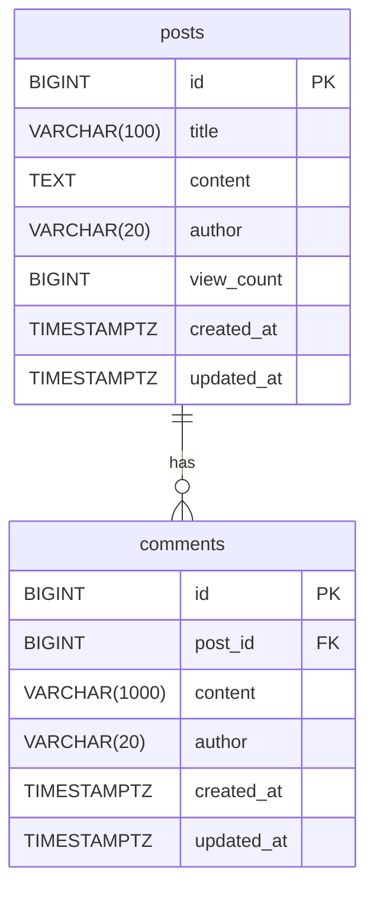

# 도메인 모델 / DB 스키마

엔티티 설계와 Flyway 마이그레이션의 기준 문서. 스키마를 바꾸면 이 문서도 같이 갱신한다.

## ERD



## 연관관계 설계

- `Comment → Post` **단방향** `@ManyToOne(fetch = LAZY)`.
- `Post`에 `List<Comment>` 컬렉션을 두지 않는다. 댓글 목록은 `CommentRepository`에서 페이징으로 조회한다.
  - 이유: 컬렉션 매핑은 페이징과 함께 쓰기 어렵고, cascade/orphanRemoval로 인한 의도치 않은 대량 로딩을 막기 위함.
- 게시글 삭제 시 댓글 삭제는 **DB FK의 `ON DELETE CASCADE`**에 맡긴다. 엔티티에도 `@OnDelete(action = OnDeleteAction.CASCADE)`를 붙여 매핑과 스키마를 일치시킨다.

## 타입 매핑 규칙

| Java | PostgreSQL | 비고 |
|------|------------|------|
| `Long` (PK) | `BIGINT GENERATED BY DEFAULT AS IDENTITY` | `GenerationType.IDENTITY` |
| `String` (짧은 문자열) | `VARCHAR(n)` | `@Column(length = n)`을 DDL과 일치 |
| `String` (긴 본문) | `TEXT` | **`@Lob` 사용 금지** — PostgreSQL에서 `oid`(Large Object)로 매핑된다 |
| `long` (카운터) | `BIGINT NOT NULL DEFAULT 0` | |
| `Instant` | `TIMESTAMPTZ` | 시각은 항상 UTC `Instant` |

## 엔티티 골격

```java
@MappedSuperclass
@EntityListeners(AuditingEntityListener.class)
@Getter
public abstract class BaseEntity {

    @CreatedDate
    @Column(nullable = false, updatable = false)
    private Instant createdAt;

    @LastModifiedDate
    @Column(nullable = false)
    private Instant updatedAt;
}
```

```java
@Entity
@Table(name = "posts")
@Getter
@NoArgsConstructor(access = AccessLevel.PROTECTED)
public class Post extends BaseEntity {

    @Id
    @GeneratedValue(strategy = GenerationType.IDENTITY)
    private Long id;

    @Column(nullable = false, length = 100)
    private String title;

    @Column(nullable = false, columnDefinition = "text")
    private String content;

    @Column(nullable = false, length = 20, updatable = false)
    private String author;

    @Column(nullable = false)
    private long viewCount;

    public static Post create(String title, String content, String author) { /* ... */ }

    public void update(String title, String content) { /* ... */ }
}
```

```java
@Entity
@Table(name = "comments")
@Getter
@NoArgsConstructor(access = AccessLevel.PROTECTED)
public class Comment extends BaseEntity {

    @Id
    @GeneratedValue(strategy = GenerationType.IDENTITY)
    private Long id;

    @ManyToOne(fetch = FetchType.LAZY, optional = false)
    @JoinColumn(name = "post_id", nullable = false)
    @OnDelete(action = OnDeleteAction.CASCADE)
    private Post post;

    @Column(nullable = false, length = 1000)
    private String content;

    @Column(nullable = false, length = 20, updatable = false)
    private String author;

    public static Comment create(Post post, String content, String author) { /* ... */ }

    public void update(String content) { /* ... */ }

    public boolean belongsTo(Long postId) { /* post.getId()는 프록시 초기화 없이 조회됨 */ }
}
```

## Flyway 마이그레이션

### `V1__create_posts.sql`

```sql
CREATE TABLE posts (
    id          BIGINT GENERATED BY DEFAULT AS IDENTITY PRIMARY KEY,
    title       VARCHAR(100)  NOT NULL,
    content     TEXT          NOT NULL,
    author      VARCHAR(20)   NOT NULL,
    view_count  BIGINT        NOT NULL DEFAULT 0,
    created_at  TIMESTAMPTZ   NOT NULL,
    updated_at  TIMESTAMPTZ   NOT NULL
);

CREATE INDEX idx_posts_created_at ON posts (created_at DESC);
CREATE INDEX idx_posts_view_count ON posts (view_count DESC);
```

### `V2__create_comments.sql`

```sql
CREATE TABLE comments (
    id          BIGINT GENERATED BY DEFAULT AS IDENTITY PRIMARY KEY,
    post_id     BIGINT         NOT NULL REFERENCES posts (id) ON DELETE CASCADE,
    content     VARCHAR(1000)  NOT NULL,
    author      VARCHAR(20)    NOT NULL,
    created_at  TIMESTAMPTZ    NOT NULL,
    updated_at  TIMESTAMPTZ    NOT NULL
);

CREATE INDEX idx_comments_post_id_id ON comments (post_id, id);
```

## 주요 쿼리 패턴

| 용도 | 방식 |
|------|------|
| 조회수 증가 | `@Modifying(clearAutomatically = true) @Query("update Post p set p.viewCount = p.viewCount + 1 where p.id = :id")` → 반환값 0이면 `POST_NOT_FOUND` |
| 게시글 목록 + 댓글 수 | JPQL DTO projection, 댓글 수는 상관 서브쿼리 `(select count(c) from Comment c where c.post = p)`. count 쿼리는 `countQuery`로 별도 지정(서브쿼리 제외) |
| 검색 | `lower(p.title) like lower(concat('%', :keyword, '%'))` 계열. `keyword`의 `%`, `_`는 escape 처리 |
| 댓글 목록 | `findByPostId(Long postId, Pageable pageable)`, 정렬은 Service에서 `id,asc`로 고정 |

> `LIKE '%keyword%'`는 B-tree 인덱스를 타지 않는다. v1 데이터 규모에서는 허용하고, 성능 이슈가 생기면 `pg_trgm` GIN 인덱스(새 마이그레이션)로 대응한다.
